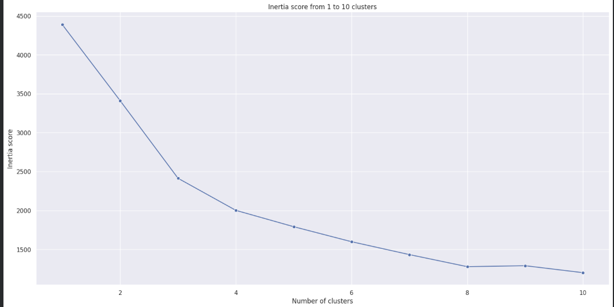
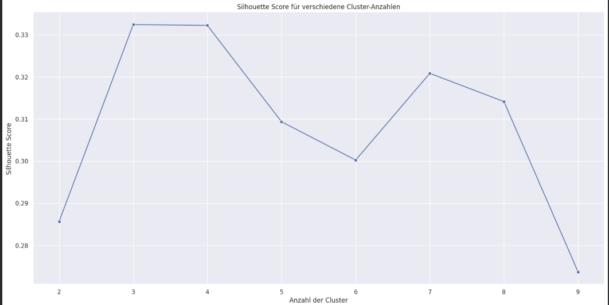
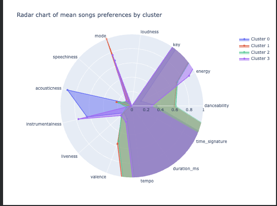
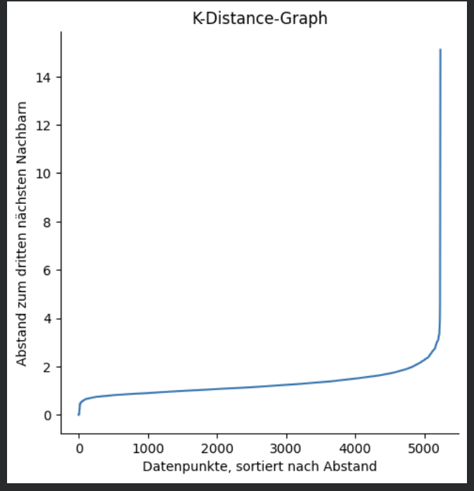
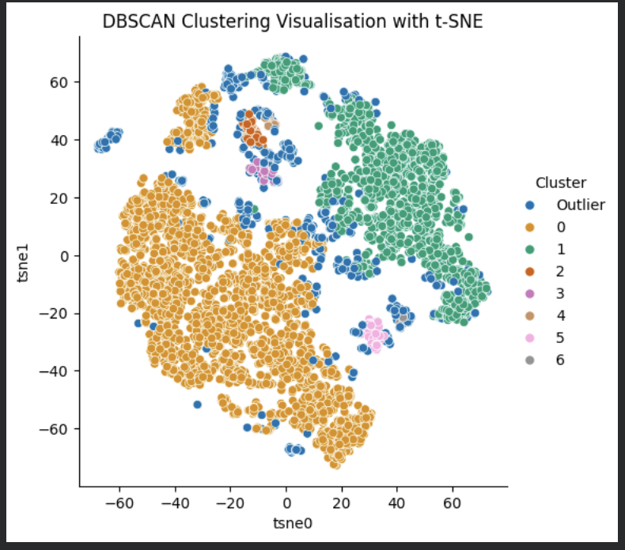
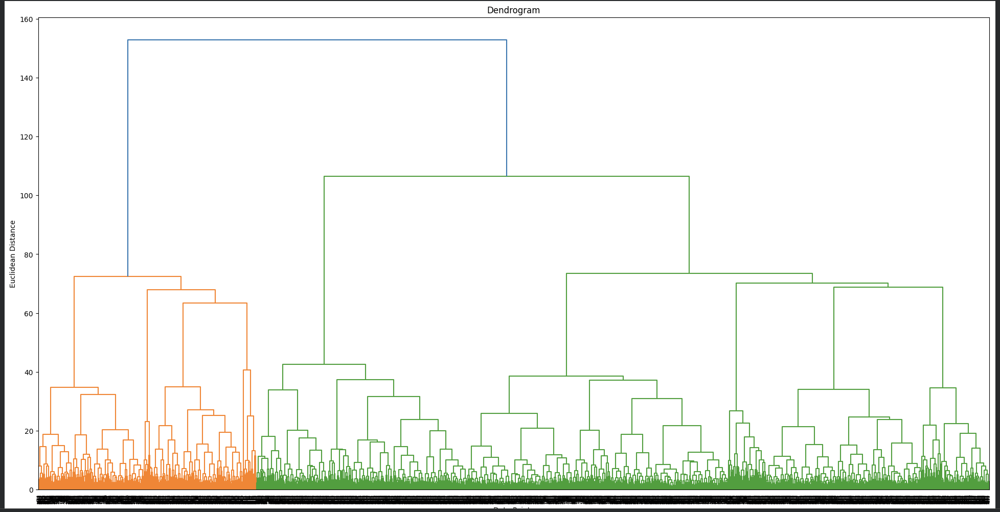
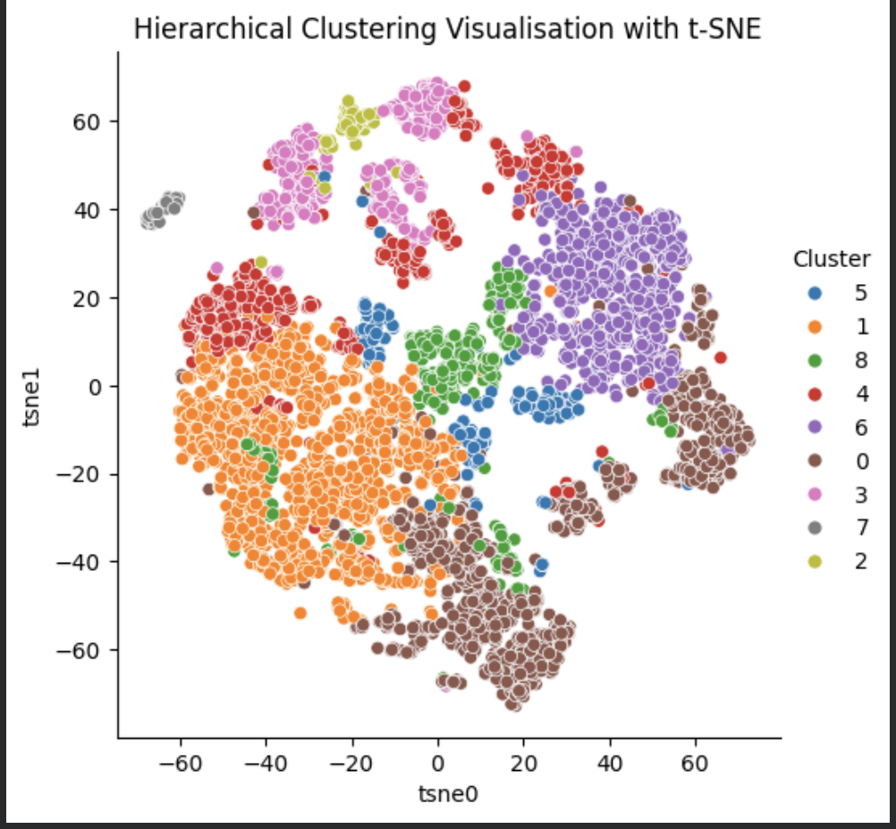

# Unsupervised Machine Learning – Music Clustering Analysis

<p align="center">


</p>

<p align="center">

<a href="https://github.com/Mustafa-Al-Hamoud/Unsupervised-Machine-Learning-Music-Clustering">


</a>

</p>

---

# Project Overview

This project explores **Unsupervised Machine Learning** techniques to discover hidden patterns and group similar songs based on their musical characteristics.

Using a Spotify songs dataset, three different clustering algorithms were implemented and compared:

- K-Means Clustering
- DBSCAN
- Agglomerative Clustering

The project also applies dimensionality reduction techniques, including **Principal Component Analysis (PCA)** and **t-Distributed Stochastic Neighbor Embedding (t-SNE)**, to reduce data dimensions, support clustering analysis, and visualize the resulting groups.

The objective is to explore how different unsupervised learning algorithms identify patterns and similarities in music data without predefined labels.

---

# Project Objectives

The project focuses on the following objectives:

- Explore and prepare the Spotify songs dataset.
- Understand and apply different Unsupervised Machine Learning algorithms.
- Identify groups of songs with similar musical characteristics.
- Apply dimensionality reduction using PCA.
- Determine suitable cluster numbers and algorithm parameters.
- Visualize clustering results using t-SNE.
- Compare the behavior and characteristics of different clustering algorithms.

---

# Key Findings

The analysis produced several observations:

- K-Means identified four clusters using PCA-transformed song features.
- PCA reduced the dimensionality of the musical features while retaining 95% of the explained variance.
- DBSCAN identified density-based groups and classified some songs as noise or outliers.
- Agglomerative Clustering generated nine hierarchical clusters using Ward linkage.
- The resulting cluster sizes differed across the algorithms.
- t-SNE provided two-dimensional visualizations of the clustering results, making the distribution of songs easier to explore.

The results demonstrate that different clustering algorithms can produce different group structures when applied to the same dataset.

---

# Project Workflow

The project followed an Unsupervised Machine Learning workflow:

```text
                Raw Spotify Dataset
                        │
                        ▼
                Data Loading & Exploration
                        │
                        ▼
                Data Cleaning & Preprocessing
                        │
                        ▼
                Feature Selection
                        │
                        ▼
                Feature Scaling
                        │
                        ▼
                Dimensionality Reduction
                        │
                        ▼
                Clustering Algorithms
                        |
            ┌───────────┼───────────┐
            ▼           ▼           ▼
         K-Means      DBSCAN    Agglomerative
                               Clustering
            |           |           |
            └───────────┼───────────┘
                        ▼
                 Cluster Evaluation
                        |
                        ▼
                 t-SNE Visualization
                        |
                        ▼
                 Result Interpretation
```

---

# Repository Structure

```text
Unsupervised-Machine-Learning-Music-Clustering/

│
├── data/
│   └── 3_spotify_5000_songs.csv
│
├── images/
│
├── notebooks/
│   ├── moosic_5000_songs_PCA_KMeans.ipynb
│   ├── moosic_5000_songs_T-SNE_DBSCAN.ipynb
│   └── moosic_5000_songs_Agglometative_Clustering.ipynb
│
└── README.md
```

---

# Project Files

## 01_PCA_KMeans.ipynb

This notebook applies PCA and K-Means Clustering to identify groups of similar songs.

Main tasks include:

- Importing libraries and loading the dataset.
- Data cleaning and feature preparation.
- Scaling musical features using MinMaxScaler.
- Applying Principal Component Analysis (PCA).
- Analyzing explained and cumulative variance.
- Selecting the number of principal components.
- Determining the number of clusters using the Elbow Method and Silhouette Score.
- Applying K-Means with four clusters.
- Analyzing cluster distribution and musical characteristics.
- Visualizing cluster characteristics using a Radar Chart.

---

## 02_TSNE_DBSCAN.ipynb

This notebook applies the density-based DBSCAN algorithm to identify groups of similar songs and detect noise points.

Main tasks include:

- Importing libraries and loading the dataset.
- Data cleaning and feature preparation.
- Scaling musical features using StandardScaler.
- Calculating nearest-neighbor distances.
- Creating a K-Distance Graph to estimate the eps parameter.
- Applying DBSCAN with eps = 2 and min_samples = 12.
- Analyzing the number of songs in each cluster.
- Identifying noise points and outliers.
- Reducing the data to two dimensions using t-SNE.
- Visualizing the clustering results.

---

## 03_Agglomerative_Clustering.ipynb

This notebook applies hierarchical Agglomerative Clustering to discover nested groups of similar songs.

Main tasks include:

- Importing libraries and loading the dataset.
- Data cleaning and feature preparation.
- Scaling musical features using StandardScaler.
- Calculating hierarchical linkage distances.
- Creating and analyzing a Dendrogram.
- Selecting the number of clusters using the Dendrogram.
- Applying Agglomerative Clustering with nine clusters.
- Using Ward linkage and Euclidean distance.
- Analyzing the distribution of songs across clusters.
- Reducing the data to two dimensions using t-SNE.
- Visualizing the hierarchical clustering results.

---

# Visualizations

The project uses several visualizations to understand the data, evaluate clustering decisions, and explore the resulting groups.

## PCA – Explained Variance

**Objective**

How much information can be retained when reducing the dimensionality of the musical features?

<p align="center">


</p>

### Key Insights

- The first principal components explain a larger proportion of the total variance.
- The cumulative explained variance helps determine the number of components required.
- The selected PCA transformation retains 95% of the explained variance.

---

## K-Means Clustering

**Objective**

How can songs be grouped based on similarities in their musical characteristics?

<p align="center">




</p>

<p align="center">



</p>

### Key Insights

- The Elbow Method and Silhouette Score were used to investigate a suitable number of clusters.
- Four clusters were selected for the final K-Means model.
- The Radar Chart helps compare the average musical characteristics of the resulting clusters.
- The clusters show differences in features such as Energy, Danceability, Acousticness, and Instrumentalness.

---

## DBSCAN Clustering

**Objective**

Can density-based clustering identify groups of similar songs and detect outliers?

<p align="center">




</p>

### Key Insights

- The K-Distance Graph was used to estimate a suitable eps value.
- DBSCAN identifies clusters based on the density of neighboring data points.
- Songs that do not belong to any cluster are classified as noise.
- t-SNE provides a two-dimensional view of the resulting clusters and noise points.

---

## Agglomerative Clustering

**Objective**

How can hierarchical clustering reveal nested groups of similar songs?

<p align="center">



</p>

<p align="center">



</p>

### Key Insights

- The Dendrogram was used to investigate and select the number of clusters.
- Nine clusters were selected for the final Agglomerative Clustering model.
- Ward linkage and Euclidean distance were used.
- The resulting clusters contain different numbers of songs.
- t-SNE visualizes the distribution of the nine clusters in two dimensions.

---

# Technologies

This project was completed using:

- Python
- Pandas
- NumPy
- Scikit-learn
- SciPy
- Matplotlib
- Seaborn
- Plotly
- Jupyter Notebook
- Git
- GitHub

---

# Skills Demonstrated

Throughout this project, the following Machine Learning and Data Science skills were applied:

- Data Loading and Exploration
- Data Cleaning and Preprocessing
- Feature Selection
- Feature Scaling
- Principal Component Analysis (PCA)
- Dimensionality Reduction
- K-Means Clustering
- DBSCAN
- Agglomerative Clustering
- Hierarchical Clustering
- Dendrogram Analysis
- Elbow Method
- Silhouette Score
- K-Distance Graph
- Cluster Analysis
- Data Visualization
- Result Interpretation
- Jupyter Notebook Documentation
- GitHub Version Control

---

# Future Improvements

Potential future enhancements include:

- Compare clustering results using additional evaluation metrics.
- Investigate different DBSCAN parameter combinations.
- Explore alternative dimensionality reduction techniques.
- Analyze and interpret the musical characteristics of each cluster in more detail.
- Build an interactive visualization dashboard.
- Explore whether the resulting clusters can support automatic playlist creation.

---

# Project Highlights

✔ Applied three Unsupervised Machine Learning algorithms

✔ Worked with a real-world Spotify songs dataset

✔ Applied PCA for dimensionality reduction

✔ Used multiple methods to investigate cluster parameters

✔ Applied density-based and hierarchical clustering

✔ Visualized clustering results using t-SNE

✔ Analyzed and interpreted cluster characteristics

✔ Documented the complete workflow in Jupyter Notebooks

---

# Author

**Mustafa Al Hamoud**

IT Engineer | Data Analytics & Machine Learning Enthusiast

GitHub: https://github.com/Mustafa-Al-Hamoud

---

## Acknowledgements

This project was completed as part of my Data Science and AI training.

The project uses a Spotify songs dataset containing musical features to explore and apply Unsupervised Machine Learning techniques.

---

⭐ **If you found this project interesting, feel free to give it a star on GitHub!**
